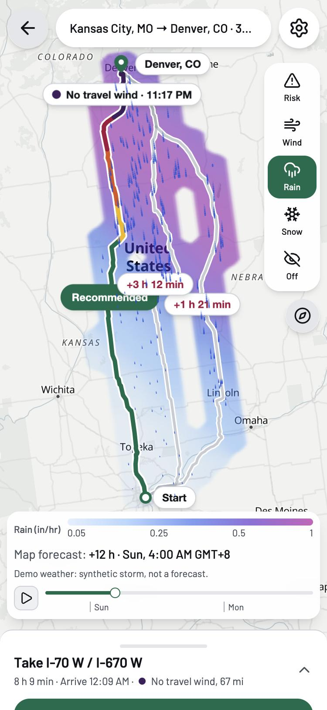
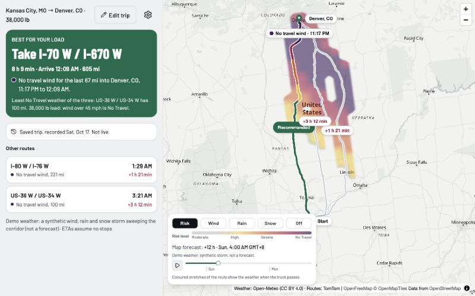
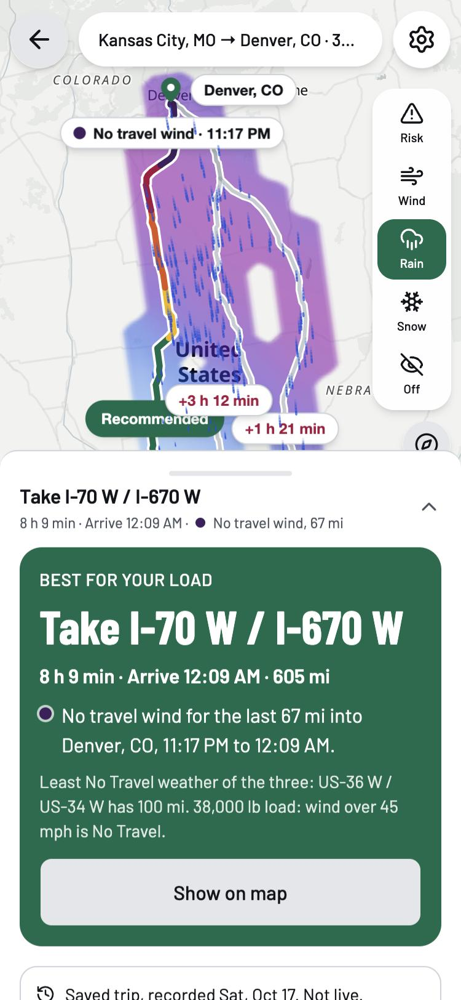
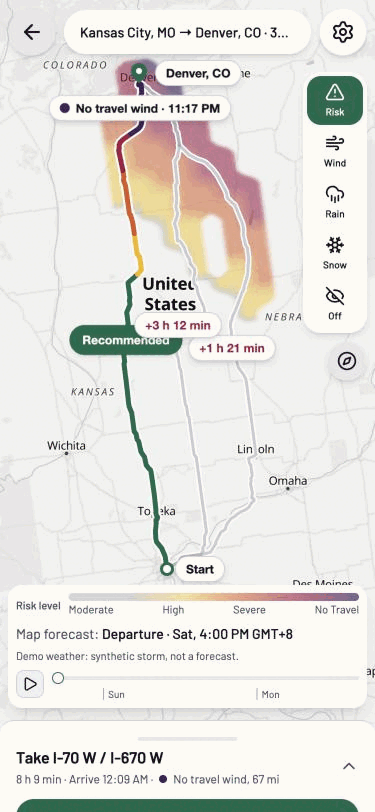
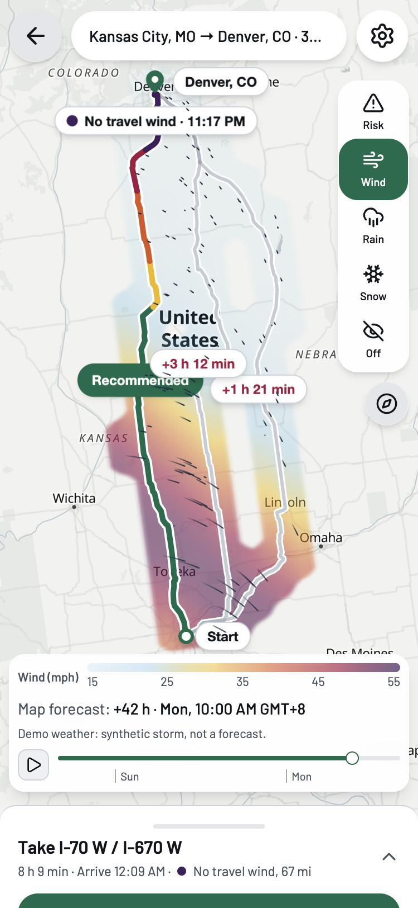
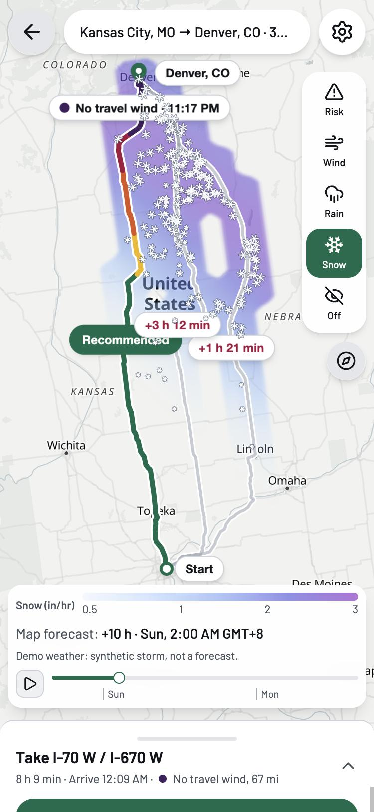
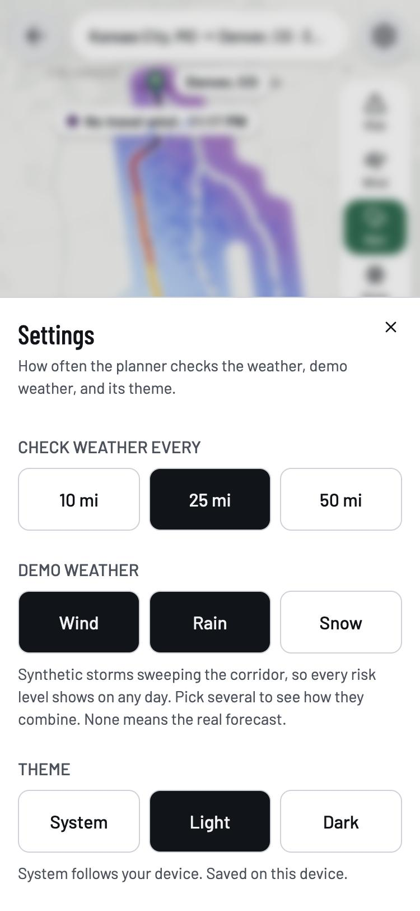
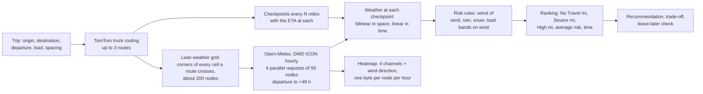

# Truck weather routes

A React + Django app that helps a truck driver pick a route by the weather the truck will actually meet. Enter origin, destination, departure time and load weight. The app gets up to three truck routes from TomTom, fetches one Open-Meteo forecast grid around them, reads the weather at a checkpoint every 10, 25 or 50 miles at the moment the truck passes it, scores every checkpoint with the assessment's risk and load rules, and recommends a route. The map colours the recommended route by risk, labels the worst stretch, and animates wind, rain and snow over a 48-hour forecast.

<p align="center">
  
  &nbsp;&nbsp;
  
</p>

## What you see

**The verdict first.** Which road, how long, when you arrive, and what you will hit on the way, with the place and the clock span. The comparison with the other roads is small print, with the wind rule your load falls under.



**Two warnings the rules alone would hide.**

- *Trade-off.* The assessment ranks hazard miles before time, so a road that is five hours faster can lose on a 50-mile gap in No Travel weather. When another road is at least an hour faster than the recommended one, a red alert names it, the time it saves, and the hazard miles it adds.
- *Leave later.* The forecast grid already covers 48 hours, so the recommended route is rescored at 3, 6, 12 and 24 hours later for free. When a later departure has fewer No Travel, Severe or High miles, the card says so: "Leave 12 h later, at Sun 4:00 AM: no No Travel weather (now 67 mi)."

**The map.** The recommended route is drawn in the colour of each stretch's risk level, with one label at the worst checkpoint. The other routes carry a tappable pill with their time against the best one. A labelled pin marks the destination and a ring the start. On a phone the map is rotated so the trip runs up the screen (the compass button turns north up again), the layer picker is a labelled rail, and the route cards rest in a sheet at one line.

**Forecast layers over 48 hours.** Risk, wind, rain or snow as a smooth corridor heatmap, with a slider, day ticks, and a play button that sweeps the two days in twelve seconds.



**Weather you can see move.** Wind is streaks that follow the wind over the ground. Rain is streaks falling down the screen with a lean, thicker and faster the harder it rains. Snow is six-arm flakes drifting slowly, bigger where it is heavier. All three live only where the weather is, so the pattern itself shows the storm.

<p>
  
  
  
</p>

**Demo weather.** Real forecasts are mostly calm, so a grader may never see Severe. Settings has a demo switch: synthetic wind, rain and snow storms sweeping the corridor on the same grid a forecast would use, singly or together. With wind and rain on at once, the risk at each point is the worse of the two, which is exactly how the rules combine them. Every plan built this way says "Demo weather: synthetic storm, not a forecast".

## How a plan is made



1. **Routes.** TomTom Calculate Route in truck mode, with the load plus an assumed 35,000 lb empty truck as the vehicle weight, returns up to three routes with the time at every maneuver. That gives the ETA profile along each route.
2. **Checkpoints.** One every N miles from the origin, plus the destination. Each checkpoint owns half the gap to its neighbours, so a route's owned miles add up to its length.
3. **Weather.** One grid of forecast points around the routes: the corners of every grid cell a route passes through, at the finest step that keeps it at about 200 points. The points go to Open-Meteo in parallel chunks of 50, hourly from departure to 48 hours later or the last ETA, whichever is further. A plan fetches weather once; nothing polls in the background. Checkpoints read the grid at their ETA, bilinear between the four nodes around them and linear between the two hours. Wind direction is interpolated through its components so it never turns the long way round through north.
4. **Risk.** Each checkpoint's level is the worst of its wind, rain and snow levels from the assessment table, with the load rules applied to wind.
5. **Recommendation.** Routes are ranked by No Travel miles first, then the assessment's order: Severe miles, High miles, average risk, travel time. The card names the criterion that decided it, adds the trade-off alert when a much faster road lost, and the leave-later line when waiting helps.

All scoring is Python in `backend/planner/`. The frontend displays, it does not decide.

### The rules

| Level | Wind (sustained, mph) | Rain (in/hr) | Snow (in/hr) |
|---|---|---|---|
| Low | under 25 | under 0.10 | under 0.5 |
| Moderate | 25 to 35 | 0.10 to 0.25 | 0.5 to 1.0 |
| High | 35 to 45 (Severe over 40,000 lb) | 0.25 to 0.50 | 1.0 to 2.0 |
| Severe | 45 to 55 (No Travel over 30,000 lb) | 0.50 to 1.00 | 2.0 to 3.0 |
| No Travel | 55 and over | over 1.00 | over 3.0 |

A value on a boundary belongs to the higher band (25 mph is Moderate). No Travel starts at 55 mph wind but above 1.00 in/hr rain and 3.0 in/hr snow, as the assessment writes it.

## APIs and data

| Provider | Used for | Terms that matter |
|---|---|---|
| [TomTom](https://developer.tomtom.com/) Routing and Search | Truck routes with maneuver times; place search | Key required, kept server side only. The developer terms are behind a sign-in; check them before caching responses commercially. |
| [Open-Meteo](https://open-meteo.com/), DWD ICON model | Hourly wind, gusts, wind direction, rain, showers, snowfall | Free tier is non-commercial: 600 locations a minute, 10,000 a day. CC BY 4.0, credited on the map. |
| [OpenFreeMap](https://openfreemap.org/) | Basemap tiles, Positron by day and Dark at night | © OpenMapTiles, data © OpenStreetMap contributors, credited on the map. |

A plan costs one TomTom routing call, four Open-Meteo calls of about 50 locations, and whatever place searches the driver typed. The two saved trips in `backend/data/samples/` were recorded on 2026-10-17 and cost nothing to open.

## Gotchas and limits

- **Caching.** Provider answers are cached in memory for 30 minutes, never whole plans. TomTom routes are keyed by origin, destination, load and departure rounded up to the next 15 minutes, so every departure in that window shares one routing call while ETAs still count from the exact departure. Each Open-Meteo chunk is keyed by its request, which is already whole hours. Place search is cached by query. Whether TomTom allows caching routing responses at all was not verified, since the terms sit behind a sign-in. For a commercial deployment, read them first.
- **The cache and the rate limits are per process.** Django's in-memory cache means each Vercel function instance starts cold and counts its own limits, so the real limit across instances is higher than the numbers below. A shared cache such as Redis would fix both; for a proof of concept it is not worth the extra service.
- **Rate limits.** `/api/plan` allows 10 requests a minute per IP and `/api/geocode` 60. Over that the API answers 429 `rate_limited` with `Retry-After`. Behind a proxy, set `DJANGO_NUM_PROXIES=1` so the limit keys on the client IP and not the proxy's.
- **Time budget.** A plan must finish in 40 seconds, and each provider call gets what is left of that budget as its timeout; when it runs out the API answers 504 `plan_timeout`. Routing and weather cannot overlap, because the weather grid is built from the route shapes. A 600-mile trip plans in 3 to 5 seconds, a 1,700-mile trip in about 9, most of it TomTom. Before the weather fetch was split into parallel chunks, one 200-location request for a long trip took 20 seconds and timed out. On Vercel the function's own duration limit also applies.
- **Grid detail.** Checkpoint weather is interpolated between grid points about 25 to 110 km apart depending on the trip's length, so very local storms can be smoothed out. The plan reports the grid step and the number of points.
- **Times.** Departure is entered in the viewer's time zone and stored as UTC. Every time the app shows, including the times on the map and in the card, is in the viewer's zone; the browser sends it as `viewer_tz` with a plan and as `?tz=` for a saved trip.
- **Continuous driving.** No rest stops or hours-of-service; ETAs are TomTom's travel times spread between maneuvers at constant speed.
- **US only**, departure within the next 48 hours, load 0 to 80,000 lb.
- The saved trips saw clear weather on the day they were recorded, so neither shows a hazard on its own; demo weather on a saved trip does.

## Security

- The TomTom key lives only in the server's environment. The browser never sees it, and every provider call goes through one HTTP helper whose errors and log lines carry no URL, parameters or key.
- Logs are one key=value line per provider call (`provider_call provider= status= ms= cache=hit|miss`) and per plan (`plan_built ms= routes=`) to stdout.
- Sentry is off unless `SENTRY_DSN` is set. When on, it sends no personal data (`send_default_pii=False`) and drops HTTP breadcrumbs, so request URLs with keys never reach it.
- With `DJANGO_DEBUG=0` the server refuses to start without `DJANGO_SECRET_KEY`, and `DJANGO_ALLOWED_HOSTS` must name the host.
- Per-IP throttles on the two public endpoints, keyed on the real client IP behind the proxy.
- No database, no accounts, nothing stored about a user. `.env` is ignored by git.

## Testing

| Suite | Count | What it runs on |
|---|---|---|
| Backend `pytest` | 197 | Recorded TomTom and Open-Meteo responses in `backend/tests/fixtures/`; no network |
| Frontend `vitest` | 174 | Pure view-model and particle tests, component tests with Testing Library, a MapLibre fake |

```bash
cd backend && uv run pytest -q && uv run ruff check .
cd frontend && pnpm typecheck && pnpm lint && pnpm test && pnpm build
```

**API contract.** `backend/tests/test_contract.py` builds a plan from the recordings and checks it against `frontend/src/test/plan-contract.json`; `frontend/src/api/planContract.test.ts` parses the same file with the frontend's Zod schemas and fails if a field is lost or changed. After changing the plan's shape, refresh the file with `UPDATE_CONTRACT=1 uv run pytest tests/test_contract.py` from `backend/`, then fix whichever side fails.

## Deliberately not built

- **Playwright end-to-end tests.** Deferred until the product stops moving; this week every screen changed shape twice. Component tests on recorded responses cover the behaviour today, and an end-to-end suite would need recorded network or live keys in CI. The `.gitignore` already has the Playwright folders ready.
- **A shared cache.** Per-process is enough for a proof of concept; see Gotchas.
- **Rest stops and hours-of-service.** ETAs assume continuous driving.
- **Live traffic, closures, chain laws.** TomTom's static truck routing only.
- **Outside the US**, and departures beyond 48 hours.
- **Accounts, saved plans, history.** Nothing persists between visits except the theme.
- **A real forecast for the demo.** Demo weather is synthetic on purpose and always labelled.

## Run it locally

Needs Python 3.12 with [uv](https://docs.astral.sh/uv/), Node 24 with pnpm, and a TomTom API key.

```bash
cp .env.example .env   # then set TOMTOM_API_KEY in .env
```

Backend (port 8000):

```bash
cd backend && uv sync && uv run python manage.py runserver 127.0.0.1:8000
```

Frontend (port 5173, proxies `/api` to the backend):

```bash
cd frontend && pnpm install && pnpm dev
```

Open http://127.0.0.1:5173. Without a TomTom key, the two saved trips under the form still work, and so does demo weather on them.

Re-record the saved trips with `uv run python scripts/record_samples.py` from `backend/` (needs the key; the recorder gives itself 3 minutes instead of the API's 40 seconds).

## Deploy

`vercel.json` deploys one Vercel project with two services: the Vite build for the page and Django for `/api/*`. Set `TOMTOM_API_KEY`, `DJANGO_SECRET_KEY`, `DJANGO_DEBUG=0`, `DJANGO_ALLOWED_HOSTS` (the `.vercel.app` host) and `DJANGO_NUM_PROXIES=1`; `SENTRY_DSN` is optional.

## API in short

- `POST /api/plan` with origin, destination, `departure_utc`, `load_lb`, `spacing_mi`, `viewer_tz`, and optionally `demo` as `"wind"`, `"rain"`, `"snow"` or a comma-separated mix. Returns routes with checkpoints and summaries, the recommendation (with `leave_later`), the weather source, and the heatmap.
- `GET /api/samples` and `GET /api/samples/<id>?tz=<zone>&demo=wind,rain` for the saved trips.
- `GET /api/geocode?q=` for place search.

## Repository

```
backend/    Django + DRF API. planner/ holds rules, sampling, ranking, routing, weather, later, plan, demo, explain
frontend/   Vite + React + TypeScript, MapLibre, shadcn/ui. planner/ holds the screen, map and model
docs/adr/   architecture decisions
docs/readme/ the pictures above
GLOSSARY.md the terms used in code and docs
```
